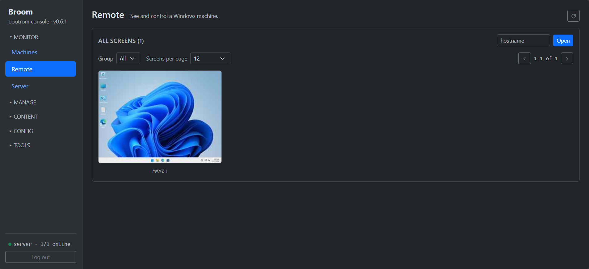
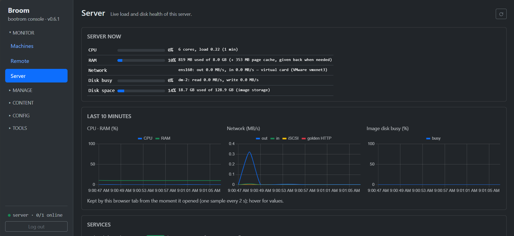
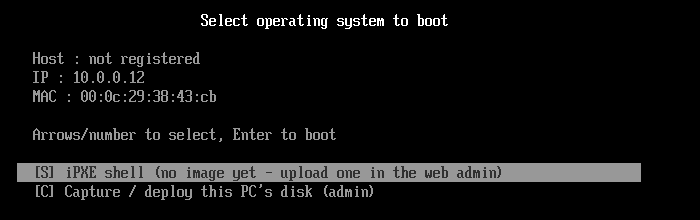
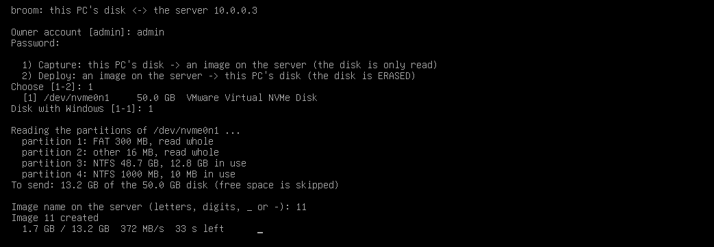

<p align="center"></p>

# Broom — open-source diskless boot server for Windows 11 & Linux

[](https://github.com/morningstar-sudo/broom/releases/latest)
[](LICENSE)

Network-boot a room of PCs from **one golden image**: every reboot comes up clean. One static Rust binary on any
Linux server, with DHCP, TFTP, iSCSI and the web admin built in. Made for internet cafés, gaming centers and school
labs, up to ~100 PCs per server (see [Sizing](#sizing)).

- **Secure Boot on, no MOK**: every step of the network boot is signed through Microsoft's UEFI CA. With TPM 2.0 +
  HVCI, **FACEIT Anti-Cheat works**.
- **Clean every boot**: Windows 11 Pro or Linux clients; writes go to the local SSD and are reset at the next boot.
- **One file to deploy**: no dnsmasq, tftpd or targetcli. Build the golden in a VM (or capture a real PC) and
  upload it from the browser.
- **Shared iSCSI disks** for games and apps: update once, every PC gets it at its next boot.
- **Remote in the browser**: a live wall of every PC's screen, click one to take over. Full-screen games included,
  no port open on the PCs.
- **Health and logs**: CPU, RAM, temperatures, SMART / bad sectors for every PC and the server; logs with filter and
  live follow.
- **Snapshots, machine groups, driver packages.** Free, Apache-2.0.

**Guides:** [broom.hainth.edu.vn](https://broom.hainth.edu.vn/)

## Screenshots

| | |
|---|---|
|  |  |
| Windows 11 client: C: is the shared golden, G: an iSCSI disk | Remote: every client's screen on one wall |
|  |  |
| Server: live load and 10-minute charts | FACEIT Anti-Cheat: Secure Boot, TPM, HVCI all pass |
|  |  |
| Boot menu with **[C] Capture / deploy** | Capturing a PC's disk as an image |

## How it works

1. Build a golden in a VM (Linux, or Windows 11 Pro), or capture a real PC.
2. Upload it in the web admin: the server extracts the disk, builds the boot files and serves it.
3. Clients PXE-boot it read-only; their writes land on the local SSD and are reset at each boot.
   - **Windows:** the golden is cached on the SSD as `golden.vhdx` (downloaded once per new golden, checked with
     sha256 while it downloads) and Windows boots natively from a child VHDX that is recreated every boot. The server
     makes `golden.vhdx` on the fly from the raw disk; with the image's cache set to RAM it serves a compressed copy
     from memory.
   - **Linux:** read-only iSCSI root + `overlayroot`, writeback on the SSD (or in RAM).

Each Windows PC specializes the golden once (name, license) and keeps that as its **base**; driver packages go into
their own layer over it. Every boot resets to `base ← drivers ← fresh child`.

| | Broom | Commercial suites (e.g. CCBoot) | LTSP | FOG Project |
|---|---|---|---|---|
| Open source | yes (Apache-2.0) | no | yes | yes |
| Server | any x86_64 Linux, one binary | Windows | Linux | Linux |
| Windows / Linux clients | yes / yes | yes / — | no / yes | yes / yes |
| Model | diskless (reset every boot) + imaging (capture / deploy a PC's disk) | diskless | thin/fat clients | imaging |

## Requirements

- **Server:** x86_64 Linux (tested on Debian/Ubuntu and Rocky Linux 10), run as root, disk space for the goldens.
- **Clients:** x86_64 UEFI PCs, **PXE first in the boot order**. Windows images need a local SSD; Linux images can
  run without one (writes in RAM).

## Sizing

Nothing in Broom caps the number of machines; the server's link, disk and RAM do. Traffic comes from a new golden
going out after a publish and from the iSCSI disks while people play (Windows itself runs from each PC's SSD).

| Room | Server link | Image / iSCSI disk | RAM |
|---|---|---|---|
| up to 30 PCs | 1 GbE | SSD | 16 GB |
| 30–60 PCs | 10 GbE | NVMe | 32 GB |
| 60–100 PCs | 2× 10 GbE bonded (LACP) or 25 GbE | NVMe (PCIe 4) | 64 GB+, iSCSI disk cached in RAM |

- **Bonding** is set up on the server's OS: `802.3ad` with `xmit_hash_policy=layer3+4`, LACP on the switch. Then
  pick the bond (e.g. `bond0`) as the DHCP interface. One PC never gets more than one link's speed.
- **Switches:** 1 GbE to the PCs, a 10 GbE uplink per access switch, **PortFast / edge port** on the PC ports
  (classic spanning tree holds a port ~30 s at each link-up, twice per boot).
- **New golden:** machines download it a few at a time at full speed (Windows → *Golden downloads at once*; Auto =
  server link / 1 Gbit/s). A 30 GB golden reaches 100 PCs in about half an hour on 20 Gbit/s: publish off-hours.
- Measure on the **Benchmark** page (server disk, each PC's boot time and read speed) and watch the **Server** page.

## Quick start

Use a **fixed directory**: the images and the database live next to the binary.

```bash
sudo mkdir -p /opt/bootrom && cd /opt/bootrom
sudo curl -fLO https://github.com/morningstar-sudo/broom/releases/latest/download/bootrom-mgmt
sudo chmod +x bootrom-mgmt
sudo ./bootrom-mgmt install-service      # systemd unit; flags after it (e.g. --port 8080) go into the unit
journalctl -u bootrom-mgmt -f            # shows the one-time setup token
```

The first start detects the network and downloads the release's `broom-assets.zip` (web UI, iPXE, scripts); the first
Windows publish fetches `broom-stage.tar.gz` (client stage). **Offline server:** copy both files of the same release
next to the binary. To upgrade: stop the service, replace the binary, start it.

Open `http://<server-ip>/`, enter the setup token and set the owner password. Then the network boot:

- **Keep the router's DHCP** and set its PXE options: next-server / option 66 = the Broom server, boot file /
  option 67 = `snponly.efi` (Secure Boot clients: `sb/snponly-shim.efi`); or
- **Turn on Broom's DHCP server** (Network page) after switching the router's off: interface, range, gateway, DNS.
  It is off by default, since two DHCP servers break a LAN.

**Register the PCs** (Machines / Devices) before their first Windows boot: on a registered PC with one internal disk
the stage lays out the SSD by itself. Any other PC asks on screen which disk to wipe (Enter = touch nothing). On a PC
with several disks, pick the Broom disk under Devices → *Disks* and optionally hide the others from the guest.

**Secure Boot:** tick **Secure Boot clients** (Network page) and enable the "Microsoft 3rd-party UEFI CA" on the PCs.
Clients then get the iPXE project's signed build and kernels signed for Ubuntu's shim; no MOK enrollment. Golden
drivers must be HVCI-compatible (e.g. VMware: use `e1000e`, not `e1000`).

## Adding a golden

Upload the powered-off VM folder (only `.vmx` / `.vmdk` are sent, in parallel chunks with retry), or a single
`.vmdk` / `.img` / `.zip`.

- **Linux:** in the VM, `curl -fsSL http://<server>/broom-prep | sudo bash`, power off, upload (OS = Linux).
- **Windows 11 Pro:** set the guest user (Windows page), then in the VM, in Audit Mode (Ctrl+Shift+F3 at OOBE),
  PowerShell as Administrator:
  ```powershell
  irm http://<server>/broom-prep-win | iex
  ```
  It syspreps and powers off; upload (OS = Windows). The script holds the guest password and is readable on the boot
  LAN, like the golden itself.
- **Capture a real PC:** run the same prep on the PC, then PXE-boot it and pick **[C] Capture / deploy → Capture**.
  Sign in with an owner account, pick the disk, name the image. Only what NTFS uses is sent (40 GB of Windows on a
  1 TB disk sends ~40 GB). BitLocker must be off; keep C: small, since every client gets a C: that size.
- **Deploy** (same menu): write an image's full disk onto a PC's disk (erased) so it boots that Windows natively.
  Change apps there, prep again, capture it back.

## Windows clients

- **Base:** built once per PC on its first boot, and again after a new golden, a rename or a license key. The PC
  restarts once by itself; every later boot resets to it.
- **Base mode** (Machines page, per PC + one image): that PC keeps everything over as many restarts as needed
  (Windows Update, an anti-cheat's first run). Turned off, its next boot saves it as the base. The Machines page marks
  it **BASE**; don't leave it on for guests.
- **Drivers** (Drivers page): packages matched by hardware ID, group or "all machines". A changed set is installed
  once into a driver layer over the base (one extra restart); later boots start with it. Two packages for the same
  device: Windows picks (best match, then newest `DriverVer`).
- **iSCSI disks** (iSCSI Disks page): game libraries on the server, mounted read-only under a drive letter, writes
  kept on the PC's SSD until reboot. Pick an **update machine**, boot it, install, shut down, **Save**: a new
  version, picked up by each PC at its next boot. **Cache** serves a disk from the server's RAM.
- **SSD room** (Windows page): the stage frees *Keep free* GB each boot; a watchdog warns the guest below *Warn* and
  restarts below *Restart* (a full SSD would blue-screen Windows). *Pagefile*: N GB on the SSD, new every boot.
- **Strict reset** (Network page): Windows can only start through PXE. Without it a PC whose PXE fails boots its SSD
  without the reset; the Machines page flags it "not reset".
- **DNS only for healthy PCs** (Network → DNS): the server is the clients' DNS and answers only PCs whose Remote
  agent runs, PCs that just booted, and exempt groups / IPs. Block outside DNS (53, 853) on the router.
- **Remote:** a small agent (`broom-vnc`) dials out to the server; the wall streams only the page shown, the single
  view uses H.264 on Chrome / Edge. Ctrl+Alt+Del, Windows key, Alt+Tab and Paste from the toolbar.

The Windows scripts and helpers are the server's, not the image's: a new server version reaches every PC at its next
boot without a republish.

## Groups, images, versions

- A machine's **group** decides its boot menu, the images kept on its SSD, its iSCSI disks and drivers (Groups page).
  Things set for no group go to everyone. This organizes, it is not access control.
- **Preload** (Windows images): PCs fetch the image ahead of use while booting another one.
- **Versions:** snapshot / roll back a golden (hard links, instant); **→ New image** turns a version into an image.
- **Export:** a VMware VM (`.vmx` + `.vmdk`) of an image or version, to edit it again.

## Web admin

| Group | Pages |
|---|---|
| Monitor | **Machines** (state, health, license, Wake / Manage / Remote, base mode), **Remote**, **Server** (load, charts, disks, services) |
| Manage | **Devices** (register, import, per-PC detail and disks), **Groups** |
| Content | **Images**, **iSCSI Disks**, **Drivers** |
| Config | **Network** (DHCP, Secure Boot, strict reset, DNS), **Windows** (guest user, SSD room, downloads), **Settings** (users, boot menu) |
| Tools | **Benchmark**, **Logs** |

Accounts: **owner** (everything) or **staff** (look, Remote, Wake, save a games update; no deleting or settings).

## Data, backup

```
/opt/bootrom/
├── bootrom-mgmt     # the binary
├── bootrom.db       # config, accounts, machines, license keys, images (SQLite)
├── images/<name>/   # image.img = the golden (raw, sparse)
├── storage/         # image versions (hard links)
├── games/<name>/    # iSCSI disks
├── disks/<id>/      # other server disks Broom formatted / mounted (Server → Disks)
├── tftp/            # boot files, rebuilt by Publish
└── work/            # scratch
```

Overrides: `BOOTROM_HOME`, `BOOTROM_IMAGES_DIR`, `BOOTROM_STORAGE_DIR`, `BOOTROM_DB=sqlite:///path/bootrom.db`.

**Backup:** `bootrom.db` (`sqlite3 bootrom.db ".backup /backup/bootrom.db"`, keep it private: license keys and the
guest password), `images/` + `storage/` together while no publish runs (`rsync -aSH`), `games/`, and `disks/<id>/`
(or follow the symlinks with `rsync -L`). Restore: stop, put the files back, start.

**Forgot the owner password:** stop the service, `sqlite3 bootrom.db "DELETE FROM config WHERE key='users'"` (removes
every account), start it: a new setup token is printed.

## Security

Every admin page and `/api/*` route needs a login (argon2, signed session cookie, `Host` check, throttled after 5
failures). Boot endpoints stay open, since a PXE client can't log in. What the network must do:

- **Segment the boot LAN.** The goldens (HTTP) and iSCSI (`:3260`) are readable by any host on it. Keep guest Wi-Fi
  and unknown laptops off it, and keep real secrets out of goldens.
- **Isolate the admin PC** or turn on port isolation: the web admin is plain HTTP, and port isolation also stops ARP
  spoofing from guest PCs.
- License keys go to a PC once, over plain HTTP, while its base is built.
- iSCSI writes are accepted only from a disk's update machine (IP + MAC).
- Remote agents dial out; each PC has its own key, both sides prove it at every connection and every command is signed.
- The guest is a local administrator (games need it): disk hiding, strict reset and DNS gating keep the room clean,
  they are not locks.

## Build

- **Windows:** `build.cmd` (runs in WSL `Ubuntu-24.04`). **Linux / WSL:** `./build.sh`. Output `mgmt/dist/bootrom-mgmt`.
- Needs Rust stable via [rustup](https://rustup.rs) (toolchain pinned in `mgmt/rust-toolchain.toml`), `musl-tools`,
  `git`, `gcc`, `make`, `perl`, `liblzma-dev`. The binary is static (musl): it runs on any x86_64 Linux.
- **iPXE** is fetched at `mgmt/ipxe/IPXE_COMMIT`, patched with `mgmt/ipxe/patches/` and embedded; rebuilt only when
  those change (`--ipxe` forces it).
- A local build has no Windows stage bundle. Make one on an Ubuntu machine with a `-generic` kernel and copy it next to
  the binary:
  ```bash
  sudo mgmt/dist/bootrom-mgmt build-stage /tmp/stage --kernel "$(ls /lib/modules | grep -- -generic$ | sort -V | tail -1)"
  ```
- CI (`.github/workflows/build.yml`) tests, builds the static binary, the Windows helpers and the stage bundle, and
  releases every push to `main`.

```
mgmt/
├── src/        # server: boot menu, images, publish, capture, dhcp / tftp / iscsi, winstage + vhdx, Remote, auth
│   ├── iscsid/ # the iSCSI target daemon
│   └── db/     # `Db` trait + SQLite
├── scripts/    # client side: stage.sh, broom-*.ps1, broom-fw.cs, broom-vnc.cs
├── static/     # web admin
└── ipxe/       # iPXE commit + patches; signed/ = official Secure Boot builds
```

## FAQ

**Do the clients need a disk?** Windows: yes, a local SSD (cache + session writes keep boots fast and the server
idle). Linux: no.

**How many machines?** About 100 per server with the hardware in [Sizing](#sizing). The rooms running it today are
small: grow gradually and watch the Server page.

**Anti-cheat (FACEIT)?** Works with Secure Boot, TPM 2.0 and HVCI on. If it needs a first run on each PC, use
**Base mode** for that PC.

**Free?** Yes, Apache-2.0, including commercial use.

## License

Apache License 2.0, see [LICENSE](LICENSE) and [NOTICE](NOTICE). The binary embeds **iPXE** (GPLv2 with the UBDL
exception): its source is upstream iPXE at `mgmt/ipxe/IPXE_COMMIT` plus `mgmt/ipxe/patches/`; `mgmt/ipxe/signed/`
holds unmodified official builds. `broom-stage.tar.gz` is made of unmodified Ubuntu binaries under their own licenses
(`SOURCES.txt` inside lists each package).
