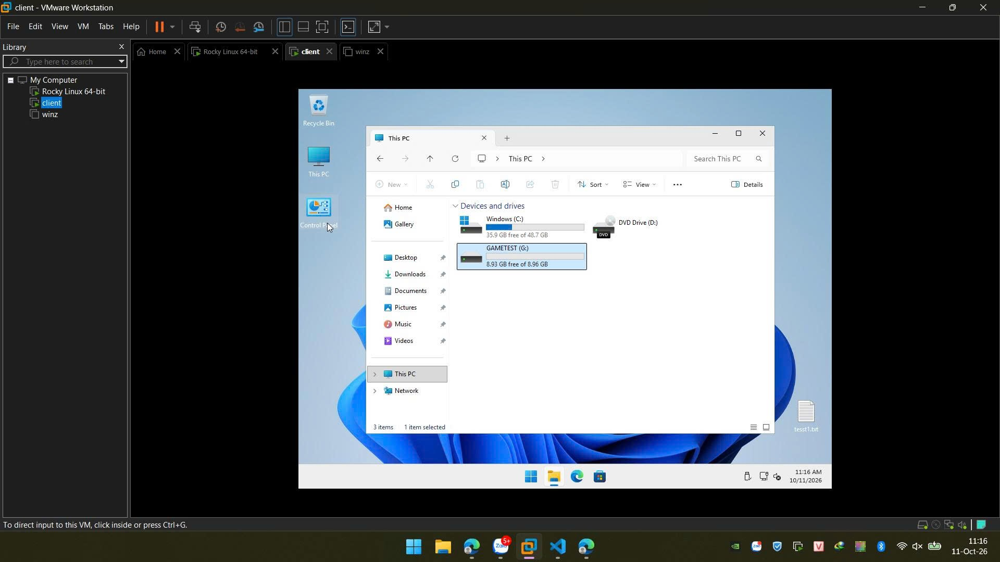
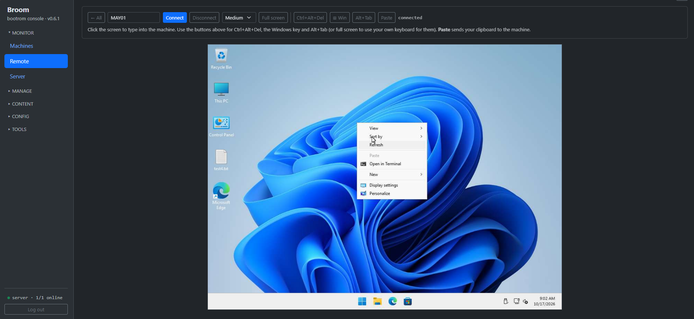
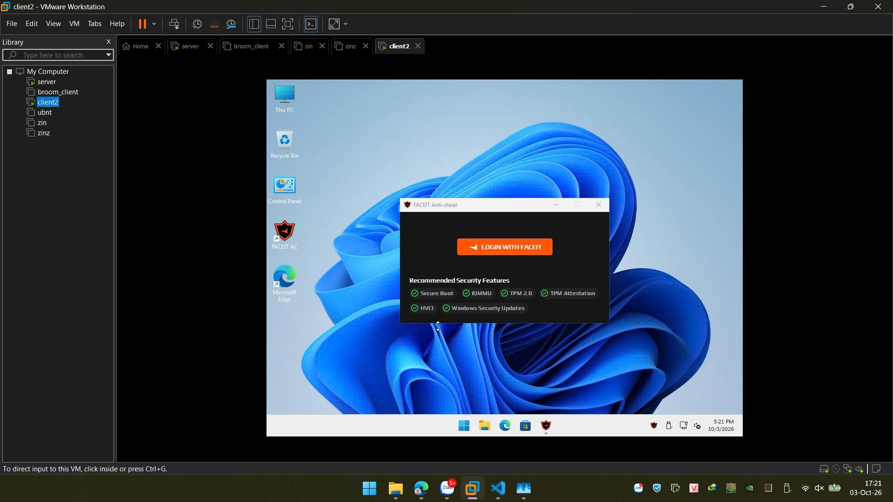
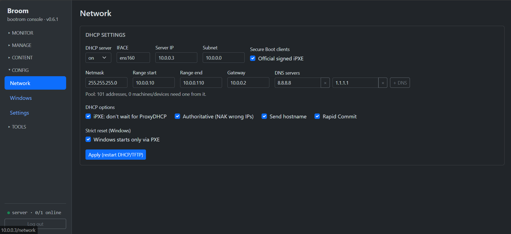

<p align="center"></p>

# Broom — open-source diskless boot server for Windows 11 & Linux

[](https://github.com/morningstar-sudo/broom/releases/latest)
[](LICENSE)

Network-boot a room of PCs from **one golden image** — every reboot comes up clean. One static Rust binary on any
Linux server, DHCP / TFTP / iSCSI / web admin built in. For internet cafés, gaming centers and school labs — up to
~100 PCs per server with the hardware in [*Sizing*](#sizing).

- **Secure Boot on, no MOK** — every step of the network boot is signed through Microsoft's UEFI CA: no keys to
  enroll, no MokManager screen on any client. With TPM 2.0 + HVCI, **FACEIT Anti-Cheat works**.
- **Clean every boot** — Windows 11 Pro or Linux clients; writes go to the local SSD and are reset at the next boot.
- **One file to deploy** — no dnsmasq, tftpd, targetcli; build the golden in a VM and upload it from the browser.
- **Games disks** — update a game once, every PC gets it at its next boot.
- **Remote control in the browser** — a live wall of every PC's screen; click one to take over mouse and keyboard.
  Full-screen games show too. No VNC client to install, no port open on the PCs.
- **Health at a glance** — CPU %, RAM %, temperatures and each disk's SMART status / bad sectors, for every PC and the
  server.
- **Snapshot / rollback, machine groups, web admin.** Free, Apache-2.0.

**Guides:** [broom.hainth.edu.vn](https://broom.hainth.edu.vn/)

## Screenshots

**Windows 11 client booted from Broom** — C: is the shared golden, G: a games disk:



**Remote** — a client's screen in the web admin, controlled with the mouse and keyboard:



**FACEIT Anti-Cheat on a Broom client** — Secure Boot, IOMMU, TPM 2.0, TPM attestation and HVCI all pass:



**Web admin — DHCP settings:**



## Broom compared with

| | Broom | Commercial diskless suites (e.g. CCBoot) | LTSP | FOG Project |
|---|---|---|---|---|
| Open source | yes (Apache-2.0) | no | yes | yes |
| Server | any x86_64 Linux, one binary | Windows | Linux | Linux |
| Windows clients | Windows 11 Pro | yes | no | yes |
| Linux clients | yes | — | yes | yes |
| Model | diskless, reset every boot | diskless | netboot thin/fat clients | imaging (clone onto the local disk) |

## How it works

1. Build a golden **in a VM** (Linux or Windows 11 Pro).
2. Upload the VM folder to the web admin — the server extracts the disk, builds the boot files and
   serves it.
3. Clients PXE-boot the golden read-only; their writes land on the local SSD and reset each boot.
   - **Linux:** RO iSCSI root + `overlayroot` (writeback on the SSD, reset every boot).
   - **Windows:** `golden.vhdx` cached on the SSD, a child VHDX that resets every boot. The server never stores
     `golden.vhdx`: it is made from the image's raw disk while it is downloaded (a VHDX is a small header + the raw
     disk's blocks), so a publish costs one read of the image (its sha256), not a 50 GB copy. With the image's cache set
     to RAM, the server keeps a compressed copy of `golden.vhdx` in memory and every download comes from it — a room
     fetching a new golden at once never hammers the server's disk.

## Performance

What a Windows client loads on every boot, before Windows itself starts from its SSD:

| Step | Size / time |
|---|---|
| iPXE (TFTP, the only file over TFTP) | ~0.3 MB |
| Stage kernel + initrd (HTTP) | ~15 MB + ~38 MB |
| Stage work: reset the session, sync scripts / drivers, set the boot order | about 1 s |

- **One DHCP per boot phase:** iPXE asks DHCPv4 only (no IPv6 router discovery wait) and the stage reuses iPXE's
  address instead of asking again.
- **A new golden is downloaded once per machine** and checked (sha256) while it downloads — no second read of a
  multi-GB file. Machines that already have it download nothing.
- Boot time end to end depends on the hardware (firmware POST and PXE, network, SSD, the golden's own Windows start):
  measure yours on the **Benchmark** page — server disk, and per machine its boot time (every boot) and disk / network
  read speed (on request, at its next boot). The **Server** page shows the live load and iSCSI throughput.
- **After a publish, machines download the new golden in turns** — a few at a time at full speed (Windows → *Golden
  downloads at once*; Auto = the server's link speed over 1 Gbit/s), so they come up one batch after the other
  instead of all finishing together at the end.

## Requirements

- **Server:** x86_64 Linux (tested on Debian/Ubuntu and Rocky Linux 10), run as root; disk space for the goldens;
  Gigabit LAN.
- **Clients:** x86_64 UEFI PCs with network boot (PXE). Windows images need a local SSD; Linux images can also run
  without one (writes kept in RAM).

## Sizing

Nothing in Broom caps the number of machines. What grows with the room is the network traffic — a new golden going
out to every PC after a publish, and the games disks' reads while people play (Windows itself runs from each PC's
SSD) — so the server link, its disk and its RAM decide how big a room one server carries:

| Room | Server link | Image / games disk | RAM | Notes |
|---|---|---|---|---|
| up to 30 PCs | 1 GbE | SSD | 16 GB | |
| 30–60 PCs | 10 GbE | NVMe | 32 GB | the page cache keeps the games played most |
| 60–100 PCs | 2× 10 GbE bonded (LACP) or 25 GbE | NVMe (PCIe 4) | 64 GB + | games disk in RAM (**Cache** on the Games page) if the RAM holds it |

- **Bonding:** `802.3ad` with `xmit_hash_policy=layer3+4` on the server, LACP on the switch (one switch, or a stacked
  / MLAG pair). One PC never gets more than one link's speed; a room of them spreads over both.
- **Switches:** 1 GbE to the PCs is enough; give each access switch a 10 GbE uplink. Turn on **PortFast / edge port**
  on the PC ports — classic spanning tree holds a port ~30 s each time its link comes up, which a PC does twice per
  boot.
- **Addresses:** the DHCP pool must hold every PC without a fixed IP plus the phones and laptops — the Network page
  warns when it gets tight (the default `.100–.200` is 101 addresses). Or give the PCs fixed IPs (Devices).
- **Publishing a new golden:** machines download it in turns (Windows → *Golden downloads at once*, Auto = the server
  link over 1 Gbit/s: 20 at a time on 2× 10 GbE), each at its full speed. A 30 GB golden reaches 100 PCs in about half
  an hour on 20 Gbit/s — publish outside opening hours.
- **Remote:** the wall streams only the page of screens shown (choose how many per page), so a room of 100 costs no
  more than the page you look at.
- Watch the **Server** page while the room is busy (CPU, network, disk, and the alert banner at the threshold you set);
  the **Benchmark** page measures the server disk and each PC's boot and read speed.

## Quick start (Linux server, as root)

Deploy into a **fixed directory** (images and the database live next to the binary — don't run from `/tmp`).

```bash
sudo mkdir -p /opt/bootrom && cd /opt/bootrom
sudo curl -fLO https://github.com/morningstar-sudo/broom/releases/latest/download/bootrom-mgmt
sudo chmod +x bootrom-mgmt
# First run with no network config: setup detects the network, then serves (nothing to install).
# Any old dnsmasq / tftpd-hpa / targetcli restore service is stopped and disabled automatically.
sudo ./bootrom-mgmt
```

On its first start a release binary downloads its `broom-assets.zip` (web UI, iPXE, scripts — ~1 MB) from the same
release, keeps it next to the binary and loads it into RAM at every start; without it the server does not start. The
Windows client stage (kernel + initrd + Secure Boot shim, `broom-stage.tar.gz`) is fetched the same way on the first
Windows publish. **Offline server:** download `broom-assets.zip` and `broom-stage.tar.gz` of the same release
elsewhere and copy them next to the binary; the stage is unpacked by the next Windows publish. A locally built binary
has the assets embedded and no pinned stage: see *Build* for making its bundle.

Then open `http://<server-ip>/`:

- **Set the admin password.** While none is set, every start prints a one-time **setup token** to the log
  (`no admin password yet — open http://… and enter the setup token: …`); the first-run page asks for it, so only
  someone who can see the server's console/log can claim the install. Every admin action needs a login.
- **DHCP: off by default** (a second DHCP server breaks a LAN that already has one). Either:
  - keep it off and set your router's PXE options: next-server / option 66 = the broom server's IP, boot file /
    option 67 = `snponly.efi` (Secure Boot clients: `sb/snponly-shim.efi`). broom always serves iPXE over TFTP; iPXE
    then fetches `autoexec.ipxe` from it, which chains the boot menu; or
  - turn the **DHCP server on** (Network page) after switching the router's DHCP off: interface, range, gateway and
    DNS (gateway + DNS are required; setup pre-fills them from the server's own network). DNS: one box per server,
    up to 8, in order of preference (**+ DNS** adds one). Optional DHCP behaviour (ticks, same page):
    - **iPXE: don't wait for ProxyDHCP** (on) — option 175.176: iPXE takes this server's answer at once (saves 2 s).
    - **Authoritative** (on) — NAK a machine with a lease/static IP here asking for an address that isn't its own.
    - **Send hostname** (on) — option 12 = the machine's name on the Machines page.
    - **Rapid Commit** (off) — RFC 4039: a client that asks for it gets the address in 2 packets instead of 4.
      UEFI PXE and iPXE never ask, so it rarely changes boot time.
- Client/boot endpoints (`/boot*`, `/tftp`, license, driver and cache-list fetch) stay open — a PXE client can't log in.

**Client machines:** UEFI, Secure Boot off (or on — see **Secure Boot** below), **PXE first** in the boot order
(required for the reset-on-boot).
**Register them** (Machines page) before their first Windows boot: the stage partitions the SSD by itself only on a
registered machine with exactly one internal disk. An unknown machine (or one with several disks) asks on its
screen which disk to wipe — type its name, or press Enter to leave the disks alone. Linux images on such a machine
keep their writes in RAM (zram) instead of touching a disk.

**One Broom SSD per machine, shared by Windows and Linux images** (other disks stay normal disks):
`p1 BROOMEFI 512M | p2 BROOMWIN (Windows) | p3 broomwb 30G + p4 broomcache (Linux)`. Whichever OS boots first lays
it out; the other only formats its own partitions, so switching images never wipes the disk. Every image a machine
boots keeps its copy there, so switching back is instant: Windows images in `broom\img.<image>\` (the one booting
sits at the top of `broom\`), Linux images as `<image>.img` in broomcache. On every boot the machine asks the server
which images it may keep (`/api/cache-list`) and removes the others (deleted, set to not use the SSD, republished);
when space runs out, the copy unused the longest goes.

**SSD on/off per Linux image** (Images page): off = "one-time" — nothing touches the SSD, the golden is read over the
network and the session's writes stay in RAM. Windows images always use the SSD (they boot from a VHDX on it).

The Linux part is sized from the Linux goldens that use the SSD (30 GB writeback + their total + 5 GB); with none,
Windows gets the whole disk. The split is set when the disk is laid out and Windows comes first: the Linux side never
lays out a disk that holds Windows' partitions — on a disk laid out before any Linux image existed (or too small for
both) Linux images run from RAM (writeback in zram, golden over iSCSI), and Linux goldens that later outgrow their
part evict each other (or boot over iSCSI). To re-split, wipe the disk (`wipefs -a`) and boot again.

### Run as a service

```bash
sudo ./bootrom-mgmt install-service            # flags after it (e.g. --port 8080) go into the unit
journalctl -u bootrom-mgmt -f                  # logs; the first-run setup token is printed here too
```

Writes `/etc/systemd/system/bootrom-mgmt.service` (runs the binary from its own directory, restarts on failure,
keeps any `BOOTROM_*` / `RUST_LOG` set in your shell), then enables and starts it. Stop a foreground instance first —
both want ports 67/69/80. To upgrade: `systemctl stop bootrom-mgmt`, replace the binary, `systemctl start bootrom-mgmt`.

**Secure Boot:** tick **Secure Boot clients** on the Network page. Clients then get the official iPXE signed
by the iPXE project (`mgmt/ipxe/signed/`, via its Microsoft-signed shim) instead of broom's own build, and the kernels
boot through Ubuntu's Microsoft-signed shim — no MOK enrollment, every link is signed by a key the shims already
trust: the Windows stage runs Ubuntu's Canonical-signed generic kernel from the
stage bundle (whatever distro/kernel the server has), and Ubuntu goldens' own kernels pass the same shim. Goldens of
other distros need their kernel signed for that shim. On the clients: enable
Secure Boot and the "Microsoft 3rd-party UEFI CA" (often off on Secured-core PCs). The menu footer (Host / IP / MAC)
then shows as lines under the images. Untick to go back to broom's own iPXE. TPM 2.0, VBS / Memory integrity (HVCI)
and IOMMU work on the clients too — broom-prep-win turns on VBS + HVCI in the golden (runs where the client has VT-x);
drivers in the golden must be HVCI-compatible (e.g. the VMware `e1000` NIC driver is blocked — use `e1000e`).

## Web admin

The menu is grouped (each group folds; the one holding the open page stays open):

| Group | Page | What it does |
|---|---|---|
| Monitor | **Machines** | every machine: on/off, health badge, license, Wake / Manage / Remote |
| | **Remote** | live wall of every Windows machine's screen; click one to control it |
| | **Server** | the server's CPU / RAM / network / disk load, its disk's SMART, live iSCSI; alert threshold, RAM reserve |
| Manage | **Devices** | register / edit / import machines, a machine's detail (lease, license, drivers, health) |
| | **Groups** | which images, games disks and drivers each group of machines gets |
| Content | **Images** | goldens: upload, publish, cache (disk / RAM), versions, export, boot menu |
| | **Games** | shared games disks and their update machine |
| | **Drivers** | driver packages installed into each Windows machine's base |
| Config | **Network** | DHCP server, Secure Boot clients, strict reset |
| | **Windows** | guest user, SSD room, golden downloads at once |
| | **Settings** | admin password, boot menu countdown |
| Tools | **Benchmark** | server disk speed; per machine boot time and disk / network read speed |

A banner on every page shows when the server stays at its resource limit (Server → *Resource alert*).

## Adding a golden

Build the golden in a VM, power it off, then upload the whole VM folder (only `.vmx` / `.vmdk` are
sent, in parallel 8 MB chunks with retry) — or a single `.vmdk` / `.img` / `.zip`.

- **Linux** — inside the VM:
  ```bash
  curl -fsSL http://<server>/broom-prep | sudo bash
  ```
  Power off → upload (OS = Linux, cache `disk` or RAM).

- **Windows 11 Pro** — set the guest user + password (Windows → Guest user), then run inside the VM in Audit Mode
  (PowerShell as Admin; also shown on the Images page):
  ```powershell
  irm http://<server>/broom-prep-win | iex
  ```
  The script carries the guest password and is readable by anyone on the boot LAN (like the golden itself). The VM
  syspreps and powers off by itself → upload (OS = Windows).
- **Base build on each machine:** on its first boot (and after a new golden, a rename or a driver change) every
  Windows machine specializes the golden once and saves that as its *base*; every later boot resets to it. By default
  the base is saved automatically (the machine restarts by itself after the first logon). Tick **Base mode** on an
  image when a technician must set something up on each machine first (e.g. an anti-cheat's first run): the first
  logon then waits on the desktop, and the restart the technician does saves the base — so don't leave a machine in
  base mode to guests.
- **Strict reset** (Network page): Windows can then only start through PXE — the SSD's Windows boot entries are kept
  out of the boot order and Windows deletes its boot loader from the SSD after each start (the stage puts it back on
  the next PXE boot). Without it, a machine whose PXE fails (cable out, server down) still boots Windows from the SSD,
  without the reset; the Machines page flags such boots ("not reset"). The guest account is a local administrator
  (games need it), so a determined guest can still interfere with the boot setup of the machine they sit at — keep
  the boot LAN segmented and check the flag.

## Machine groups: images, SSD cache, games disks

A machine's **group** decides what it gets; everything set for no group goes to every machine (registered or not).
The **Groups** page shows each group with its machines, images, games disks and driver packages, and edits them in one
place (create / rename / delete a group; tick what belongs to it). Removing the last group of an image or games disk
asks first: it would then go to every machine.

- **Images → Groups**: the boot menu lists only the images of the machine's group (choosing another one by hand is
  refused). Default entry: the machine's own image if on its menu, else the global default; neither → no countdown.
  This organizes the menus, it is not access control — the goldens themselves are readable on the boot LAN.
- **SSD cache**: a machine keeps on its SSD only the images of its group (`/api/cache-list` answers per machine); an
  image taken off its group is removed from its SSD at its next boot. Each image is downloaded once and kept (Windows:
  `broom\img.<image>\` with its base; Linux: the cache partition); the one unused the longest goes when space runs out.
- **Preload** (Windows images): the machines of its groups fetch it onto their SSD ahead of use, while booting another
  image (that boot takes longer once per publish), so choosing it later needs no download — only its base is built on
  its first boot. Only into free space beyond the session's room: a preload never evicts anything.
- **Games disks** (below): each disk for some groups, or all.

### SSD room (Windows)

Everything a guest writes (C:, games drives) lands on the machine's SSD until the next boot. **Windows → SSD room**:
the stage frees *Keep free* GB at each boot (parked images, unused the longest first); during the session a watchdog
(`broom-watch.ps1`) checks the SSD every 15 s — below *Warn* it tells the guest and flags the machine (*SSD full* on the
Machines page), below *Restart* it restarts the machine after 60 s. Without it Windows stops with a blue screen once
the SSD is full (it can't grow its boot VHDX) — and C: shows the VHDX's virtual free space, so Windows never warns.
Big writes come mostly from launchers updating games on the machines: let only the games disk's update machine do it.

## Games disks (Windows)

**Games** page: disks on the server (`games/<name>/games.img`, sparse) for the Windows machines — game
libraries live there instead of in the golden. A machine gets every disk of its group plus those for all machines, each
under its drive letter (two disks a machine could both get can't share one). The iSCSI daemon serves them read-only;
each machine opens the `games.vhdx` inside through a differencing VHDX on its own SSD (`broom\games-<name>-child.vhdx`,
deleted every boot), so a guest's writes stay on that machine until reboot and a games disk never changes. Mapping
changes apply at each machine's next boot; nothing in the golden changes.

To install or update games: pick the disk's **update machine** → (re)boot it → that drive is writable there (its writes
are kept apart on the server) → install → shut it down properly → **Save**: a new version (`g1`, `g2`…) at once, no
copy — the changed blocks become a layer over `games.img`. Each machine gets the new version at its next boot; machines
already playing keep theirs. Once no machine has used an older version for 10 minutes, the layers are merged into
`games.img` in the background. A new disk is formatted by its first update machine; the size can only grow (the update
machine extends the drive on its next boot). No rollback for a games disk — back up its `games.img`.
A disk's **Cache** button serves it from a copy in the server's RAM (loaded in the background, read from the file
meanwhile) — it needs about as much free RAM as the games on it, since game files barely compress.

The Windows scripts (`broom-done`, `broom-bootorder`, `broom-games`, `broom-watch`) and the helpers they run
(`broom-fw`, the `broom-vnc` agent) are the server's, not the images': written to `tftp/broom-scripts/` at every start
and checked by the stage on every boot, so a new version reaches every machine without a publish. Images published
before this version need **Publish** once to switch over.

## Remote (Windows)

**Remote** (Monitor group, or the **Remote** button on the Machines page) shows a **wall** of thumbnails — one live
screen per Windows machine — and clicking one takes it over in the browser, nothing to install on the admin's side.
Type a hostname to go straight to a machine (`/remote?host=PC-01` works as a bookmark). The wall goes page by page
(screens per page: 6 / 12 / 24 / 48 or your own number; filter by group): only the page shown is streamed and
decoded — the other machines do not even capture their screen — and a hidden browser tab streams nothing. A machine
someone is controlling shows "in use" on the wall: a thumbnail never takes it away from them.

- **Mouse, keyboard, scroll**: click the screen first so keys go to the machine (layout-independent: physical keys are
  sent). Toolbar: **Ctrl+Alt+Del**, the **Windows key** and **Alt+Tab** (the browser only lets your own keyboard send
  those in full screen), **Paste** (puts your clipboard on the machine and presses Ctrl+V), **Full screen**, quality.
- **Full-screen games show**: the screen is captured with Desktop Duplication; the UAC prompt and the lock screen are
  captured too (GDI on the secure desktop).
- **Smooth on Chrome / Edge**: the single-machine view streams H.264 (decoded by the browser); other browsers, or a
  machine that can't encode, get JPEG of only the changed parts. The wall uses small JPEG thumbnails, about one a
  second.
- **No port on the machines**: each one runs a small agent (`broom-vnc`, as SYSTEM in the console session) that dials
  out to the server and keeps one connection open; only a signed-in admin can watch through the server. Nothing on the
  machine shows that it is being watched — tell your guests if your rules need it.
- The agent starts at every Windows boot, also while a base is being built (from the first logon on), and logs to
  `C:\Windows\Temp\broom-vnc.log`. Linux clients have no agent.

## Health monitoring

- **Machines**: the agent reports every 15 s, over the same connection, the machine's CPU %, RAM %, temperatures and
  each disk's health, temperature and **bad sectors** (SMART reallocated / pending sectors, predicted failure) — a
  badge on the Machines page (red on a failing disk or a hot machine), everything in the machine's detail (Devices).
  Temperatures come from ACPI thermal zones: no kernel driver (it would fight Secure Boot / HVCI and anti-cheats), so
  they are unlabeled and best-effort — some boards report none. Bad sectors come from SMART: no surface scan.
- **Online without ping**: a machine whose agent is connected shows online (the agent reconnects within 5 s of every
  boot). Machines without it — Linux clients, a Windows machine before its first logon — are pinged as before.
- **Server** page: the server's own load (CPU, RAM, network, image disk), its image disk's SMART (status, temperature,
  bad sectors — read with the kernel's own NVMe / SATA pass-through, no smartmontools) and live iSCSI throughput.

## Versions, export

- **Versions** (Images → Versions): snapshot / rollback the golden. A version is a hard link to the golden file of that
  moment (`storage/files/`): instant, and free until the image gets another golden — from then on each version kept
  holds its whole golden on disk, until deleted. An upload's first golden is saved as v1 by itself. Versions made by
  older releases (4 MB chunks) still restore. **→ New image** turns a version into a separate image on the list (no
  extra disk space) and publishes it.
- **Export** (per image, or per version): builds a VMware VM (`<name>.vmx` + `<name>.vmdk`) to edit the golden again —
  download both into one folder, open the `.vmx`, edit, run broom-prep again, upload. Needs free space on the server
  ≈ the golden size. Windows: works for images uploaded with this version or later (publish trims the boot partitions
  from the golden; they are now kept aside for the export).

## Data & configuration

Everything lives next to the binary:

```
/opt/bootrom/
├── bootrom-mgmt     # the binary
├── bootrom.db       # config, images, machines, leases (SQLite)
├── images/<name>/   # image.img = golden (raw, sparse)
├── storage/         # image versions (hard links to the goldens + manifests)
├── games/<name>/    # games.img = a Windows games disk; layer-N/ = newer versions not merged yet; update.* = unsaved
├── tftp/            # boot files (kernel/initrd, Windows templates, stage) — served over HTTP /tftp + TFTP
└── work/            # scratch for publish steps
```

Environment overrides: `BOOTROM_HOME` (the whole tree), `BOOTROM_IMAGES_DIR` / `BOOTROM_STORAGE_DIR`
(e.g. a bigger disk), `BOOTROM_DB=sqlite:///path/bootrom.db`.

Logs go to stdout (client boots, DHCP/TFTP, publish steps, config changes); warnings and errors to
stderr. `RUST_LOG=debug` also logs every external command. Under systemd: `journalctl -u bootrom-mgmt -f`.

## Backup & restore

| What | Why | How |
|---|---|---|
| `bootrom.db` | config, admin password, machines + license keys, images list | `sqlite3 bootrom.db ".backup /backup/bootrom.db"` while running (`apt install sqlite3` / `dnf install sqlite`), or stop the service and copy `bootrom.db*` (incl. `-wal`) |
| `images/` | the goldens (`image.img`, sparse) | stop the service or pick a time with no publish running; `cp --sparse=always -a` / `rsync -S` |
| `storage/` | image versions (hard links + manifests) | same as `images/` — copy both together, with `cp -a` / `rsync -H` (keeps the links) |
| `tftp/` | boot files | optional: rebuilt by **Publish** on each image (back it up to skip that) |
| `work/` | scratch | no |

Restore: stop the service, put the files back in the same layout, start it — iSCSI targets and RAM copies are
rebuilt at startup. `bootrom.db` holds license keys and the shared guest password: keep backups private.

**Forgot the admin password:** stop the service,
`sqlite3 bootrom.db "DELETE FROM config WHERE key='admin_pw'"`, start it again → a new setup token is printed.

## Security

The web admin and every `/api/*` route sit behind a login (argon2 password, signed session cookie) plus
a `Host`-header check. The first password needs the setup token from the server log. Wrong passwords are
throttled per client IP (after 5 failures: locked 1 s, doubling up to 5 min). **Settings → Admin password**
changes it and signs out every other session. A few properties are inherent to diskless boot on a shared LAN and are handled by
**network setup**, not the binary:

- **Segment the boot LAN.** The iSCSI portal (`:3260`) and the golden over HTTP are readable by any host
  on that segment — that is how diskless clients read their root. Put the workstations on their own VLAN,
  away from guest Wi-Fi / unknown laptops, and don't bake real secrets into a golden.
- **License keys** are handed to a machine over plain HTTP once, when its base is built — fine on a
  trusted, segmented LAN.
- **Update `disk`-cache images off-hours.** A `disk` image serves one shared golden file and refuses to
  publish or roll back while clients are connected (they would read changed bytes). Use the RAM (`zram`) cache to
  update live: each publish gets a fresh RAM copy + target, and the old one is kept until its clients drop.
- **Games disk writes** are allowed from that disk's update machine IP only (iSCSI has no other proof of who is
  connecting): a host faking that IP could write into the pending update. Check before saving; segment the LAN.
- **Remote**: watching or controlling a machine needs the admin login (the browser's connection is also checked to
  come from this web admin's own pages). The agents dial out and open no port; the server knows each one by its IP —
  like the license, a host faking a registered machine's IP could pose as it (it would only feed a fake screen).

## Build

- **Windows:** double-click `build.cmd` (runs in WSL `Ubuntu-24.04`; override with `BROOM_WSL`).
- **Linux / WSL:** `./build.sh`.

Builds iPXE only when its patches or pinned commit changed (`--ipxe` forces it), then the release binary + unit
tests (`--no-test` to skip; `--live` also runs the root-only NTFS/ping/LVM tests). Output:
`mgmt/dist/bootrom-mgmt`. Don't build with sudo.

A local build has no pinned Windows stage bundle. To publish Windows images with it, make one on a machine with
`initramfs-tools fdisk ntfs-3g dosfstools efibootmgr wget zstd shim-signed` and a `-generic` kernel installed (a
throw-away Ubuntu VM or the CI runner does), then copy it next to the binary on the server:

```bash
sudo mgmt/dist/bootrom-mgmt build-stage /tmp/stage --kernel "$(ls /lib/modules | grep -- -generic$ | sort -V | tail -1)"
scp /tmp/stage/broom-stage.tar.gz root@server:/opt/bootrom/   # next to bootrom-mgmt; the next Windows publish unpacks it
```

Requirements: **Rust stable via [rustup](https://rustup.rs)** + `musl-tools` (the binary is built static
with musl → runs on any x86_64 Linux, no glibc version issues; edition 2024, toolchain pinned in
`mgmt/rust-toolchain.toml`), plus `git`, `gcc`, `make`, `perl`, `liblzma-dev`.

**iPXE** is not vendored: `mgmt/ipxe/build.sh` fetches upstream iPXE at the commit in `mgmt/ipxe/IPXE_COMMIT`
(network needed the first time), applies `mgmt/ipxe/patches/*.patch` (boot menu layout, one-line banner)
into `mgmt/ipxe/ipxe-src/` and builds `snponly.efi`, which is embedded in the binary.
Neither is committed. To change iPXE: commit inside `ipxe-src/`, regenerate the patches (command at the top of
`mgmt/ipxe/build.sh`), rebuild.

CI (`.github/workflows/build.yml`) runs `./build.sh --ipxe` on every push / PR, compiles `broom-fw.dll` and the
`broom-vnc.exe` agent on a Windows runner (.NET Framework `csc`; a local build ships their C# source and the clients
compile it), builds the Windows stage bundle (`bootrom-mgmt build-stage` on Ubuntu's generic kernel + shim-signed) and
the assets bundle (`bootrom-mgmt pack-assets`), rebuilds the binary pinned to both (sha256 + URL appended to `mgmt/stage.pin` / `mgmt/assets.pin`,
embedded in the binary; with a pin, `build.sh` leaves the assets out of it) and publishes `bootrom-mgmt`,
`broom-stage.tar.gz`, `broom-assets.zip`, `snponly.efi` and `SHA256SUMS`; pushes to `main` are tagged
with their push time in UTC (e.g. `2026-09-19T17-05-25Z`, also the release title) and released.

## Repository layout

```
broom/
├── build.sh / build.cmd     # one-step build (Linux/WSL, or Windows→WSL)
└── mgmt/                     # the app (Rust / axum, single binary, web UI embedded)
    ├── src/                  # boot menu, images + publish, overlay (Linux), winstage + vhdx (Windows),
    │   │                     # dhcp / tftp / iscsi, machines, monitor + WOL, vnc (Remote) + metrics,
    │   │                     # sysmon (server load + SMART), setup / preflight, auth
    │   ├── iscsid/           # the iSCSI target daemon (protocol, SCSI, compressed RAM copies)
    │   └── db/               # storage: `Db` trait + SQLite (swap in another driver by adding a file)
    ├── scripts/              # client side: Windows stage (stage.sh), broom-*.ps1, broom-fw.cs, broom-vnc.cs (agent)
    ├── static/               # web admin (embedded in the binary): index.html + app.js, page fragments, login
    └── ipxe/                 # IPXE_COMMIT + patches/ → build.sh → snponly.efi embedded in the binary;
                              # signed/ = official Secure Boot iPXE (fetch-signed.sh)
```

## FAQ

**Can I run an internet café or school lab on Windows 11 without installing Windows on each PC?**
Yes. Install Windows 11 Pro once in a VM, upload it to Broom, and every PC network-boots that image. Each boot starts
from the same clean state; nothing a guest does survives a reboot.

**Do the clients need a disk?**
Windows images need a local SSD: the image is cached there and the session's writes go there, which keeps boots fast
and the server load low. Linux images can run with no disk at all (golden over iSCSI, writes in RAM).

**What does the server need?**
Any x86_64 Linux machine, run as root. Broom is a single static binary — nothing else to install.

**How many machines?**
Up to about 100 per server, given the server link, disk and RAM in [*Sizing*](#sizing): nothing in Broom caps the
count, the network and the games disk's reads are the limits. Sites running it so far are small rooms — measure yours
on the Server and Benchmark pages as you grow.

**How are games handled?**
Put game libraries on a games disk instead of the golden. Update them once from one machine; every machine gets the
new version at its next boot, while machines already playing keep theirs. A games disk can be served from a copy in
the server's RAM (**Cache** button on the Games page) — it needs about as much free RAM as the games on it.

**Can I see and control the PCs from the counter?**
Yes — the **Remote** page shows every Windows PC's screen live and lets you take one over in the browser (full-screen
games included). The Machines page also shows each PC's CPU, RAM, temperature and disk health. See *Remote* and
*Health monitoring*.

**Does it work with anti-cheat (FACEIT)?**
Yes — FACEIT Anti-Cheat runs on Broom clients with Secure Boot, TPM 2.0 and HVCI on (Network page → Secure Boot
clients), with no MOK enrollment on the clients. If an anti-cheat needs a first run on each machine, tick **Base mode** on the image (see *Adding a golden*).

**Is it free?**
Yes — Apache-2.0, free for commercial use (e.g. a paid internet café).

## License

Broom is licensed under the **Apache License 2.0** — see [LICENSE](LICENSE) and [NOTICE](NOTICE).

The binary embeds **iPXE**, © the iPXE authors and licensed **GPLv2 (with the UBDL exception)**: its
complete source is upstream iPXE at `mgmt/ipxe/IPXE_COMMIT` plus the changes in `mgmt/ipxe/patches/`
(also GPLv2 / UBDL), and `mgmt/ipxe/signed/` holds unmodified official iPXE builds. iPXE is not covered by the
Apache license; the two apply to their respective parts.

`broom-stage.tar.gz` (Releases) is made of unmodified Ubuntu binaries (Linux kernel, busybox, ntfs-3g, wget, …;
mostly GPL) under their own licenses: `SOURCES.txt` inside it lists each package + version, whose source is in the
Ubuntu archive. See [NOTICE](NOTICE).
