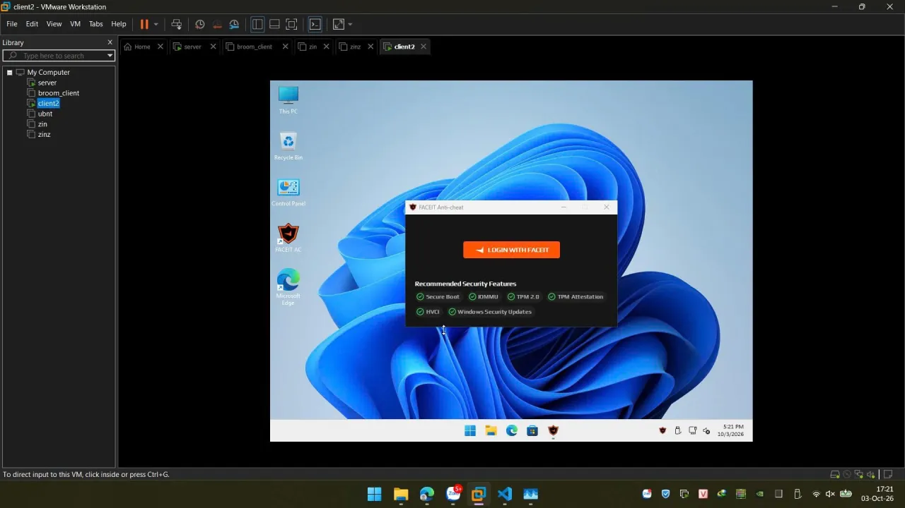

[← Broom](index.md)

FACEIT Anti-Cheat checks that the PC runs with **Secure Boot, TPM 2.0, IOMMU and HVCI (memory integrity)**. Many
diskless setups fail these checks: they boot without Secure Boot, or through a path that turns them off. Broom
clients pass them:

{: width="1280" height="720"}

## How Broom keeps them on

- **Secure Boot** — with **Secure Boot clients** ticked on the Network page, the PCs boot the official iPXE signed by
  the iPXE project through its Microsoft-signed shim, and the Windows stage runs Ubuntu's signed kernel through
  Ubuntu's Microsoft-signed shim. Every step of the network boot is signed, so Secure Boot stays on.
- **TPM 2.0** — Windows runs natively on the PC (from a VHDX on its SSD), so it uses the PC's own TPM.
- **VBS / HVCI** — `broom-prep-win` turns on Virtualization-Based Security and memory integrity in the golden.
- **IOMMU** — on where the PC's firmware enables it.

## Setup

1. **Server:** Network page → tick **Secure Boot clients** → Apply.
2. **Clients (firmware setup):**
   - enable **Secure Boot**, and allow the **Microsoft 3rd-party UEFI CA** (often off on Secured-core PCs);
   - enable **TPM 2.0** (fTPM / PTT), virtualization (**VT-x / AMD-V**) and **VT-d / IOMMU**;
   - keep network boot (PXE) first.
3. **Golden:** use drivers that are HVCI-compatible — an incompatible driver is blocked and memory integrity can't
   stay on. In a VMware VM, use the `e1000e` network adapter, not `e1000`.
4. **Anti-cheat first run:** if the anti-cheat needs to be set up on each PC once, tick **Base mode** on the image:
   the first logon on each PC waits for a technician, and their restart saves that state as the PC's base.

Untick **Secure Boot clients** to go back to Broom's own iPXE build on PCs that boot without Secure Boot — both modes
are supported.

[Diskless boot Windows 11 with Broom](windows-11-diskless-boot.md) · [Full manual](https://github.com/morningstar-sudo/broom#readme)
