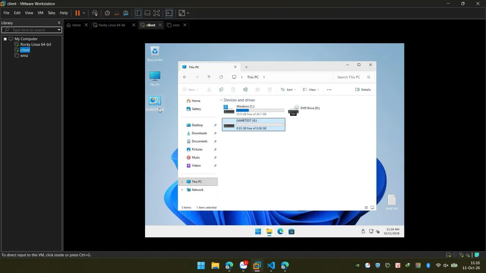
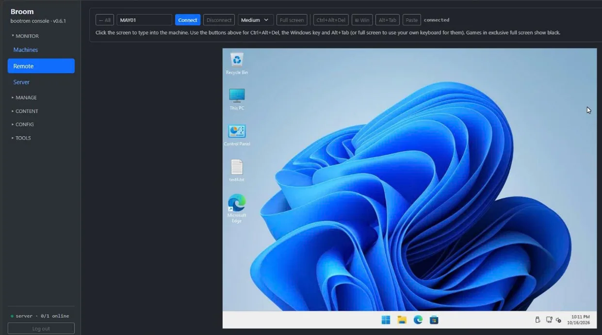
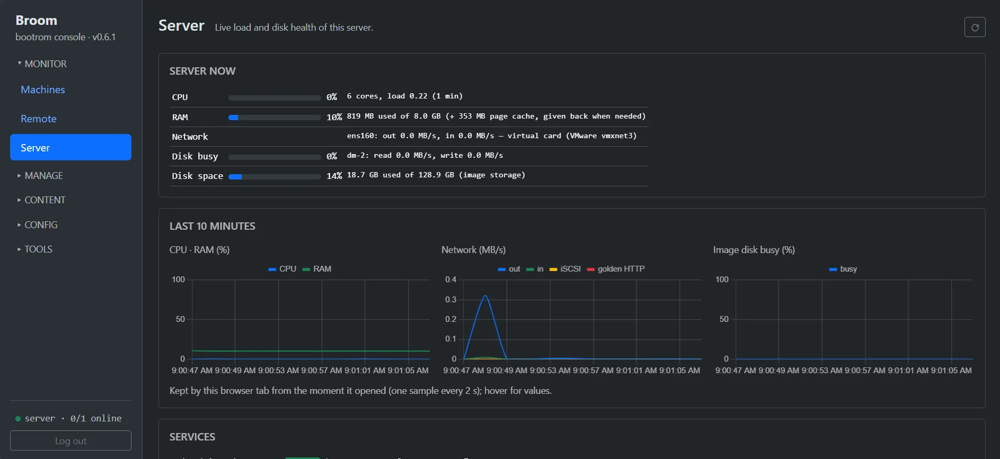

**Broom** network-boots a room of PCs from **one golden image** — every reboot comes up clean. One static binary
on any Linux server, DHCP / TFTP / iSCSI / web admin built in. Free and open source (Apache-2.0), for internet cafés,
gaming centers and school labs — up to ~100 PCs per server with the right server link
([sizing](https://github.com/morningstar-sudo/broom#sizing)).

**Secure Boot on, no MOK:** every step of the network boot is signed through Microsoft's UEFI CA — no keys to
enroll, no MokManager screen on any client. With TPM 2.0 + HVCI, [FACEIT Anti-Cheat works](faceit-diskless.md).

[Download the latest release](https://github.com/morningstar-sudo/broom/releases/latest) ·
[Source code & full manual](https://github.com/morningstar-sudo/broom) ·
[Hướng dẫn tiếng Việt](bootrom-quan-net.md)

{: width="1280" height="720"}

## Guides

- [Diskless boot Windows 11 with Broom](windows-11-diskless-boot.md) — how it works and the steps from an empty
  server to a room of clean Windows 11 PCs.
- [FACEIT Anti-Cheat on diskless PCs](faceit-diskless.md) — Secure Boot, TPM 2.0, IOMMU and HVCI on network-booted
  clients.
- [Broom vs CCBoot](broom-vs-ccboot.md) — how Broom differs from commercial diskless software, and where it is still
  behind.
- [Bootrom quán net với Broom](bootrom-quan-net.md) — hướng dẫn dựng phòng máy diskless bằng tiếng Việt.

## What you get

- **Secure Boot without MOK, TPM 2.0, HVCI** — [works with FACEIT Anti-Cheat](faceit-diskless.md).
- **Clean every boot** — Windows 11 Pro or Linux clients; writes go to the local SSD and are reset at the next boot.
- **One file to deploy** — no dnsmasq, tftpd, targetcli; build the golden in a VM and upload it from the browser.
- **Games disks** — update a game once, every PC gets it at its next boot.
- **Remote control in the browser** — a live wall of every PC's screen; click one to take over mouse and keyboard,
  full-screen games included. No VNC client, no port open on the PCs.
- **Health at a glance** — CPU, RAM, temperatures and each disk's SMART status and bad sectors, for every PC and the
  server; each PC's uptime and the traffic it draws now; live charts of the server's load and whether each of its
  services is up.
- **Logs in the browser** — the server's log with level filter, search and live follow; no SSH needed to see why a PC
  did not boot.
- **Snapshot / rollback, machine groups, web admin.**

{: width="1883" height="867"}

{: width="1887" height="867"}

## Quick start

On a Linux server (Debian/Ubuntu or Rocky Linux), as root:

```bash
sudo mkdir -p /opt/bootrom && cd /opt/bootrom
sudo curl -fLO https://github.com/morningstar-sudo/broom/releases/latest/download/bootrom-mgmt
sudo chmod +x bootrom-mgmt
sudo ./bootrom-mgmt
```

Then open `http://<server-ip>/` and follow the
[full manual](https://github.com/morningstar-sudo/broom#quick-start-linux-server-as-root).
