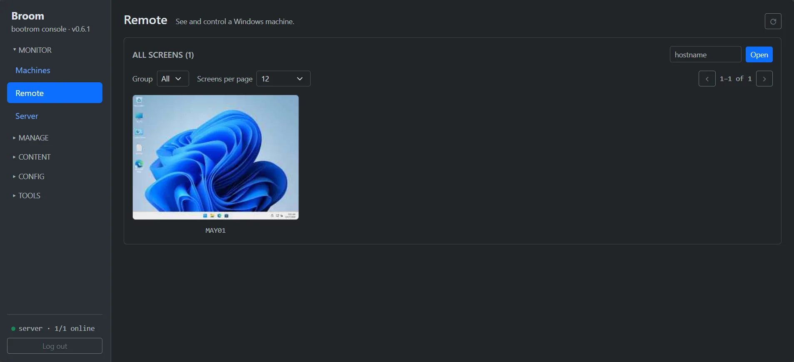

[← Broom](index.md)

**Broom** is free, open-source **diskless boot** software for **internet cafés, gaming centers and school labs**, up
to about 100 PCs per server. You install Windows 11 Pro **once** in a virtual machine and upload it to the server;
every client network-boots from that image, and every restart brings the client back **clean** — whatever a customer
installed or deleted is gone.

{: width="1280" height="720"}

## What you get

- **Clean after every boot**: everything a customer writes lands on the client's SSD and is wiped at the next boot.
- **A one-file server** on any Linux (tested on Debian/Ubuntu and Rocky Linux 10), with DHCP, TFTP and iSCSI built in.
- **As fast as a local install**: Windows runs from the image kept on each PC's SSD; the network is only used for a
  new image, so the server stays light even when the whole room boots at once.
- **Games on shared iSCSI disks**: update a game on one PC, press Save, and the whole room has it at its next boot.
- **Secure Boot without MOK**, TPM 2.0 and HVCI on, so **FACEIT Anti-Cheat runs** ([details](faceit-diskless.md)).
- **Imaging**: capture a PC's disk as an image, or deploy an image onto a PC's disk, from the boot menu.
- **Remote in the browser**: every PC's screen live on one page, click one to take over, full-screen games included.
- **Health and logs**: CPU, RAM, temperatures and disk health of every PC and the server, flagged red when something
  is wrong; the server's log searchable by PC name.
- **No agent, no internet** (optional, Network → DNS): the server is the room's DNS and only answers PCs whose agent
  runs, PCs that just booted and exempt ones (cashier, staff). Block outbound DNS (53, 853) on the router.
- **Snapshots, machine groups, driver packages, Wake-on-LAN.**
- **Free and open source** (Apache-2.0): no per-PC fee, fine for a commercial café.

{: width="1883" height="867"}

## What you need

- **Server:** an x86_64 machine running Linux, disk space for the images, Gigabit LAN to the clients.
- **Clients:** UEFI PCs with network boot (PXE) first, and **an SSD in each** (the Windows image is cached and runs
  there).
- **Image:** Windows 11 Pro installed in a virtual machine (e.g. VMware), or on one of the room's PCs and captured.

## Steps

### 1. Start the server

```bash
sudo mkdir -p /opt/bootrom && cd /opt/bootrom
sudo curl -fLO https://github.com/morningstar-sudo/broom/releases/latest/download/bootrom-mgmt
sudo curl -fLO https://github.com/morningstar-sudo/broom/releases/latest/download/SHA256SUMS
sha256sum --ignore-missing -c SHA256SUMS   # must say: bootrom-mgmt: OK
sudo chmod +x bootrom-mgmt
sudo ./bootrom-mgmt install-service
journalctl -u bootrom-mgmt -f      # shows the one-time setup token
```

Open `http://<server-ip>/`, enter the setup token and set the admin password.

### 2. Network boot

Pick one:

- **Broom's DHCP:** turn DHCP off on the router, then turn on the DHCP server on Broom's **Network** page; or
- **Keep the router's DHCP:** set next-server / option 66 = the Broom server's IP and boot file / option 67 =
  `snponly.efi`.

### 3. Build the Windows image

1. Create a VM, install Windows 11 Pro, and at the first setup screen (OOBE) press **Ctrl+Shift+F3** to enter
   **Audit Mode**.
2. Install your software and game launchers, and set things up as the whole room should have them.
3. In Broom's web admin, set the customers' account and password (**Windows → Guest user**).
4. In the VM, open PowerShell as Administrator and run:

   ```powershell
   irm http://<server-ip>/broom-prep-win | iex
   ```

   The VM prepares itself, runs sysprep and shuts down.

### 4. Upload the image

On the **Images** page, upload the whole VM folder (OS = Windows). Broom extracts the disk and publishes the image.

**No VM? Capture a client directly.** Do step 3 on one of the room's PCs (it shuts down after sysprep), then
network-boot that PC and pick **[C] Capture / deploy** at the bottom of the boot menu, then **Capture**. Choose the disk
and type the image name and an owner account: Broom only reads the disk (writes nothing) and sends only what Windows
uses (a 1 TB disk using 40 GB → about 40 GB sent), then publishes the image. Turn BitLocker off first
(`manage-bde -off C:`), and keep C: small: every client sees a C: exactly that size.

**Edit an image on a real PC.** Same menu, **Deploy**: Broom writes the image onto a PC's disk (the disk is erased) and
the PC boots straight into that Windows. Install / change apps, run the prep command again, then Capture it back.

{: width="700" height="220"}

{: width="1043" height="362"}

### 5. Add the clients and boot

Add the PCs on the **Machines** page before their first Windows boot — a registered PC with a single internal disk
gets its SSD partitioned by Broom on its own. Power them on: the first time a PC downloads the image to its SSD and
restarts once; from then on every boot is clean.

PCs with **several disks**: open **Devices → that PC → Disks** and press **Use as Broom disk** on the disk that should
hold Windows (nothing to type at the client). Better **hide the other disks from customers** (for a whole group on the
**Groups** page, or per PC): customers can't see or write them, so nothing is left behind after a restart.

**A new disk in the server:** **Server → Disks**, press **Format** on the new disk (type its name to confirm). Then pick
it when creating an image / iSCSI disk, or move an image / iSCSI disk there with the **Server disk** column on the
Images / iSCSI Disks pages.

## Installing games

On the **iSCSI Disks** page, create an iSCSI disk and choose an **update machine**. Boot that PC, install or update the
games on the iSCSI disk, shut it down properly and press **Save**. The other PCs get the new version at their next
boot. Let only the update machine download game updates — a launcher updating itself on a customer PC fills its SSD and
is lost at the restart anyway.

## Watching and controlling the clients

Open the **Remote** page (Monitor group): the screens of every Windows client show as a grid, updated live. Click a PC
(or type its name and press **Open**) to control it. Click the screen before typing. The toolbar buttons send
**Ctrl+Alt+Del**, the **Windows** key, **Alt+Tab** and **Paste** (your clipboard into the client). Chrome / Edge play
it smoothly (H.264); on a busy network lower the quality to **Low**.

{: width="1907" height="871"}

Each PC's health (CPU, RAM, temperatures, disks, bad sectors, uptime, MB/s it is downloading) shows on the **Machines**
page. The **Server** page has the server's load with 10-minute charts, disk health and the **Services** table (DHCP,
TFTP, iSCSI up or down). A PC that won't boot: open **Tools → Logs**, pick *Warn+* or type the PC's name to see the
errors.

{: width="1887" height="867"}

## FAQ


**{{ item.q }}** {{ item.a | markdownify | remove: '<p>' | remove: '</p>' | strip }}


Full manual: [github.com/morningstar-sudo/broom](https://github.com/morningstar-sudo/broom#readme)
