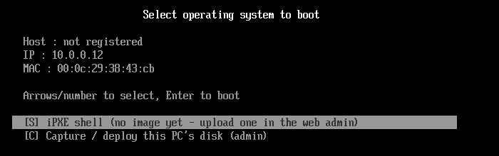
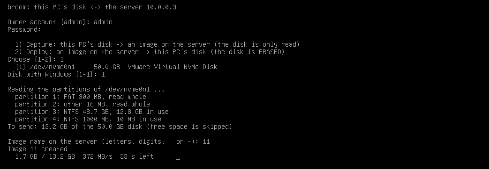

[← Broom](index.md)

Broom lets a room of PCs run **Windows 11 Pro from one shared golden image**. You install and set up Windows once,
in a virtual machine; every PC then boots that image over the network, and whatever a user changes is gone at the
next boot.

## How it works

1. The PC network-boots (UEFI PXE) and gets iPXE from the Broom server, then a boot menu.
2. A small Linux stage starts on the PC. It makes sure the PC's SSD holds the current golden as `golden.vhdx` —
   downloading it once per new golden, not every boot — and creates a fresh **child VHDX** on top of it.
3. Windows boots natively from that child VHDX. Every write the user makes goes into the child, on the local SSD.
4. At the next boot the child is thrown away and recreated: the machine is clean again.

Because Windows runs from the local SSD, it runs at local-disk speed and the server is only busy when a new golden is
rolled out. With the image's cache set to RAM, the server keeps a compressed copy of the golden in memory, so a whole
room fetching a new golden at once never hammers the server's disk.

On its first boot (and after a new golden or a rename) each PC specializes the golden once and saves that as its
**base** — its machine name and license. Driver packages (Drivers page) are installed at every boot, so a new or
updated one needs no new base. Every later boot resets to that base.

## What you need

- **Server:** any x86_64 Linux (tested on Debian/Ubuntu and Rocky Linux 10), with disk space for the goldens and a
  Gigabit LAN to the clients. Broom is one binary; nothing else to install.
- **Clients:** x86_64 UEFI PCs, network boot (PXE) first in the boot order, and a local SSD — Windows images are
  cached and run there.
- **Golden:** Windows 11 Pro, installed in a VM (e.g. VMware).

## Steps

### 1. Start the server

```bash
sudo mkdir -p /opt/bootrom && cd /opt/bootrom
sudo curl -fLO https://github.com/morningstar-sudo/broom/releases/latest/download/bootrom-mgmt
sudo chmod +x bootrom-mgmt
sudo ./bootrom-mgmt install-service
journalctl -u bootrom-mgmt -f      # shows the one-time setup token
```

Open `http://<server-ip>/`, enter the setup token and set the admin password.

### 2. Network boot

Either turn on Broom's **DHCP server** (Network page) after switching your router's DHCP off, or keep the router's
DHCP and point its PXE options at Broom: next-server / option 66 = the Broom server's IP, boot file / option 67 =
`snponly.efi`.

### 3. Build the golden

1. Create a VM, install Windows 11 Pro, and stop at the first setup screen (OOBE). Press **Ctrl+Shift+F3** to enter
   **Audit Mode**.
2. Install your software, games launchers, drivers you want everywhere, and settings.
3. In Broom's web admin, set the guest user and password (**Windows → Guest user**).
4. In the VM, run PowerShell as Administrator:

   ```powershell
   irm http://<server-ip>/broom-prep-win | iex
   ```

   The VM is prepared, sysprepped and powers off by itself.

### 4. Upload and publish

On the **Images** page, upload the VM folder (OS = Windows). Broom extracts the disk and publishes the image.

**No VM? Capture a real PC.** Do step 3 on one of your own machines instead (it powers off after sysprep), then
network-boot it and pick **[C] Capture / deploy** at the bottom of the boot menu, then **Capture**. Choose the disk,
type the image name and an owner account: Broom reads the disk (never writes it), sends only the space Windows uses
and publishes the image.
Decrypt BitLocker first (`manage-bde -off C:`), and keep C: small: every client gets a C: that size.

**Update a golden on a real PC.** The same menu, choice **Deploy**, writes an image onto a machine's disk (the disk
is erased) so it boots that Windows natively: change the apps, run the prep command again, then Capture it back.

{: width="700" height="220"}

{: width="1043" height="362"}

### 5. Register the machines and boot

Add the PCs on the **Machines** page before their first Windows boot — on a registered PC with exactly one internal
disk, Broom lays out the SSD by itself. Then boot them. The first boot downloads the golden and builds the base; the
PC restarts once by itself, and from then on every boot is clean.

## Useful options

- **iSCSI disks** — keep game libraries (and other big apps) out of the golden, on shared disks each PC mounts under a drive letter.
  Update them from one machine and save; every PC gets the new version at its next boot.
- **Base mode** — per PC and image (Machines page): the PC keeps everything done over as many restarts as it takes
  (Windows Update, an anti-cheat's first run); turned off, its next boot saves that as the base.
- **Strict reset** — Windows can only start through PXE, so a PC that misses the network boot cannot start Windows
  without the reset.
- **Versions** — snapshot the golden before a change, roll back in a click.
- **Remote** — a live wall of every PC's screen in the web admin; click one to control it with the mouse and keyboard,
  full-screen games included.
- **Health** — each PC's CPU, RAM, temperatures, disk health (SMART, bad sectors), uptime and the traffic it draws
  now on the Machines page; the server's own load with 10-minute charts, its disk health and whether DHCP, TFTP and
  the iSCSI target are up on the Server page.
- **More disks** — on a PC with several disks, pick the one Windows lives on from the web (Devices → Disks) and hide
  the others from the guest (per group or per PC), so nothing written there survives the reset. On the server, format
  a new disk from the Server page and keep images or iSCSI disks on it.
- **Logs** — the server's log in the browser (Tools → Logs): filter warnings and errors, search a PC's name, follow
  live while it boots.
- **DNS only for healthy PCs** (Network → DNS, optional) — the server becomes the room's DNS and resolves names only
  for PCs whose Remote agent runs, PCs that just booted and exempt ones (cashier, staff): an agent killed or a laptop
  plugged in gets no internet. Block outside DNS (ports 53, 853) on the router to make it stick.

The [full manual](https://github.com/morningstar-sudo/broom#readme) covers every option, backup and security.
